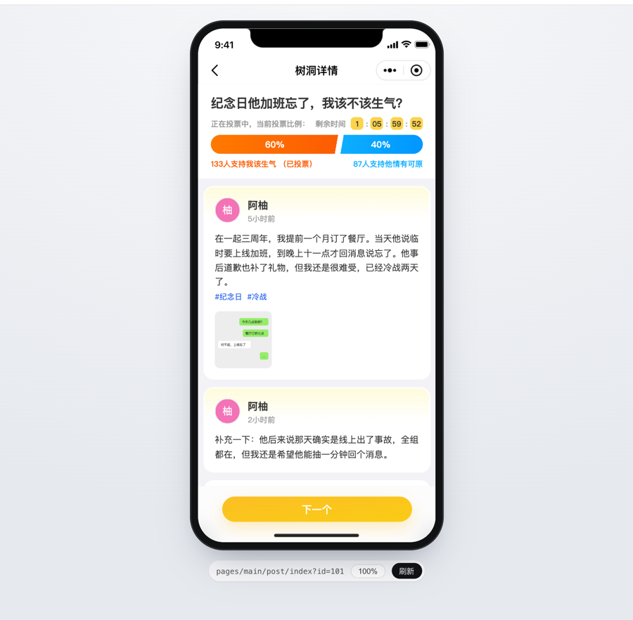

# wxa-runner

> WeChat ミニプログラムを、**公式の基礎ライブラリ**の上で、普通のブラウザーで動かします。ローカルでのデバッグとエンドツーエンドテストのために作られています。

**[ドキュメント（中国語）](https://open-wxa.github.io/wxa-runner/)** · [ライブデモ](https://wxa-viewer.picfinder.workers.dev) · [English](./README.en.md) · [中文](./README.md) · 日本語

```bash
npx wxa-runner dev ./dist/dev/mp-weixin   # a native mini program, or uni-app / Taro build output
# → http://localhost:3000
```

[ライブデモ](https://wxa-viewer.picfinder.workers.dev)：何もインストールせずに、uni-app のミニプログラムをブラウザーで開き、Web でどのように描画されるかを確認できます。
[viewer](https://open-wxa.github.io/wxa-runner/viewer)（中国語）でデプロイしており、セットアップファイルがすべての API 呼び出しにモックデータで応答するので、投票、コメント、投稿ができ、再読み込みするとすべてリセットされます。

<a href="https://wxa-viewer.picfinder.workers.dev"></a>

デフォルトでは 3.7.0 以下の基礎ライブラリを使います。それより新しいバージョン（3.7.1 以降）は明示的に選ぶ必要があります。その他については[既知の制限](#既知の制限)を参照してください。

## wxa-runner を使う理由

- **本物と同じ動き**：ミニプログラムのビルド出力をそのまま実行します。描画、コンポーネント、`setData`、ライフサイクルは、フレームワークによる H5 の再実装ではなく、WeChat の公式の基礎ライブラリのコードです
- **ヘッドレスの E2E**：開発者ツールをリモート操作する代わりに、Playwright を使ってブラウザーでテストします。CI ではヘッドレスで動き、Linux では開発者ツールが不要です
- **使い慣れたデバッグツール**：Chrome DevTools のブレークポイント、ネットワークリクエスト、DOM が使えます
- **ブラウザーでできないことは飛ばす**：アプリのコードに手を入れずに、setup でログイン状態を用意し、ネイティブ API をモックし、リクエストを横取りできます
- **どのページも直接開ける**：URL に `?path=pages/detail/detail&id=1` を付けると、開発中もテストでもそのページに直接移動します

開発者ツールの代わりになるものではありません：プレビュー、アップロード、実機でのデバッグには引き続き開発者ツールが必要です。

## クイックスタート

Node.js ≥ 18 が必要です。ミニプログラムのディレクトリ（`project.config.json` のある場所、または uni-app / Taro のビルドが生成する `mp-weixin` ディレクトリ）で実行します：

```bash
npx wxa-runner dev . --open
```

```
[wxa-runner] 编译完成：3 个页面，1 个组件，17ms

  wxa-runner 已启动
  地址      http://localhost:3000
  项目      /path/to/my-app
  基础库    3.7.0
```

ふだんの利用や CI のためには、開発用の依存関係として追加してください：`pnpm add -D wxa-runner`（または `npm i -D wxa-runner`）。

現在、CLI の出力は中国語です。基礎ライブラリやコンパイラーを別途セットアップする必要はありません：wxa-runner は、WeChat 開発者ツールがインストールされていればそのコピーを、なければ依存関係としてインストールされる同梱のものを使います。
コマンドのオプションと環境変数については [docs/cli.md](./docs/cli.md)（中国語）を参照してください。

## 使い方

### ログインを飛ばす

`project.config.json` の隣に `wxa.setup.ts` を置きます。これはミニプログラムが起動する前に実行されます：

```ts
import { defineSetup } from '@open-wxa/wxa-runner-core/setup';

export default defineSetup(({ env }) => ({
  storage: { token: env.WXA_TOKEN },                              // seed storage
  mock: { getLocation: { latitude: 31.23, longitude: 121.47 } },  // override native APIs
  network: {                                                      // intercept wx.request
    routes: { 'POST **/api/auth/login': { body: { token: env.WXA_TOKEN } } }
  }
}));
```

本物のログインコードや電話番号、WeChat サービスマーケットの呼び出し、プラグインのページが必要な場合は、`--devtools-login` を付けて起動します。これは、このマシンの WeChat 開発者ツールのログインを借ります。[docs/devtools-login.md](./docs/devtools-login.md)（中国語）を参照してください。

### ホットリロード

| 変更 | 効果 |
| --- | --- |
| ページやコンポーネント自身の `.wxml` と `.js`、およびすべての `.wxss` | ページを再読み込みせずにホットアップデートします。ページスタックとグローバルな状態は保たれます |
| それ以外（`app.js`、`.json` など） | ページスタック全体を復元する完全な再読み込み |

[docs/hot-reload.md](./docs/hot-reload.md)（中国語）を参照してください。

### Playwright でのテスト

`@open-wxa/wxa-runner-playwright` をインストールします。各ワーカーが自分の開発サーバーを起動します：

```ts
import { test, expect } from '@open-wxa/wxa-runner-playwright';

test('navigates to the result page after submitting', async ({ miniProgram }) => {
  await miniProgram.mock('login', { code: 'test_code' });  // declared before opening: already applies in App.onLaunch
  await miniProgram.open('pages/form/form');

  await miniProgram.current.locator('#submit').click();     // current always points to the current page

  await expect(miniProgram).toHavePath('pages/result/result');
  await expect(miniProgram).toHavePageData({ status: 'ok' });
  expect((await miniProgram.waitForRequest('POST **/api/form')).body).toEqual({ name: 'Ann' });
});
```

設定、モック、リクエストの横取りについては [docs/testing.md](./docs/testing.md)（中国語）を、fixture を使わずにテスト API を使う方法については [docs/test-api.md](./docs/test-api.md) を参照してください。

## 機能

| 分野 | 対応しているもの |
| --- | --- |
| 描画 | WXML、WXSS、WXS、カスタムコンポーネント、App / Page / Component のライフサイクル |
| スタイルのプリプロセス | WeChat 開発者ツールの less / sass コンパイラープラグイン（`project.config.json` の `setting.useCompilerPlugins`）が、設定なしで動きます（プロジェクトにインストールした `less` / `sass` が優先されます） |
| ルーティング | navigateTo、redirectTo などのページのルート、10 階層のページスタック、タブバー |
| サブパッケージ | 通常のサブパッケージと独立サブパッケージ、プリロード（preloadRule）、非同期サブパッケージ：ほかのサブパッケージのコンポーネント（componentPlaceholder）と JS（require.async）。すべてのコードは起動時に読み込まれるので、ダウンロードするものはありません |
| Worker | wx.createWorker：双方向のメッセージ（ArrayBuffer を含む）、terminate、サブパッケージとしての Worker。Worker の中では非同期のファイル API が使えます |
| UI | ナビゲーションバー、タブバー（カスタムタブバーを含む）、toast / modal / actionSheet。デフォルトは iPhone X です |
| コンポーネント | picker、canvas、camera、video、map（ネットワークへのアクセスが必要）、web-view |
| メディア | chooseImage、chooseMedia（画像と動画）、chooseVideo はブラウザーでファイルを選びます。previewImage、getImageInfo。アルバムへの保存は画像をダウンロードします。InnerAudioContext は音声を再生します |
| ネットワーク | プロキシ経由の request、upload、download（CORS の制限なし）、WebSocket |
| ストレージ | Storage、FileSystemManager の基本的な操作 |
| ログイン、ユーザー情報などのオープン API | 固定の偽のデータを返します。支払いとコードのスキャンはデフォルトで失敗します（[何を返すか](./docs/setup.md#mock)、中国語）。setup でモックするか、本物のログインコードが必要なら `--devtools-login` を付けて起動してください。サービスマーケットの `wx.serviceMarket` には `--devtools-login` が必要です |

実際の uni-app（Vue 3）のプロジェクトで検証しています。検証済みの基礎ライブラリのバージョンは 2.32.3、3.3.4、3.5.8、3.7.0 で、3.7.1 と 3.8.8 でもテストスイート全体が通ります。
CI がカバーしているのは同梱の 3.7.0 だけで、ほかのバージョンは `WXA_BASELIB=<version> pnpm test` でローカルで確認しています。

## 既知の制限

- 3.7.1 以降の基礎ライブラリが自動で選ばれることはありません：`--baselib` か `WXA_BASELIB` で選ぶと、検証済みの範囲外であるという警告が出ます。同梱の基礎ライブラリは 3.7.0 だけなので、新しいバージョンは先に WeChat 開発者ツールでダウンロードしてください
- 実装されていないネイティブ API は成功を返します。テストでは `errors()` で検出できます（[docs/testing.md](./docs/testing.md#检查运行时错误) を参照）
- Bluetooth などのデバイスの機能はありません
- `typescript` コンパイラープラグインには対応していません：`.ts` ファイルは読み込まれないので、先に `.js` にコンパイルしてください
- map コンポーネントの `MapContext` のいくつかのメソッド（`toScreenLocation`、`fromScreenLocation`、グラウンドオーバーレイなど）は、基礎ライブラリの Web 版の実装にないため、コールバックが呼ばれません（[PROJECT_DESIGN.md](./PROJECT_DESIGN.md#原生组件) を参照）
- プラグインのページは `--devtools-login` で動きますが、プラグインのコンポーネントと `requirePlugin` はまだ動きません（[#56](https://github.com/open-wxa/wxa-runner/issues/56)）
- Worker の中では非同期の API しか動きません：`readFileSync` のような同期の API は例外を投げ、`request`、`downloadFile`、`uploadFile`、`connectSocket` は失敗します。基礎ライブラリがそれらのタスク ID を同期的に必要とするためです。Worker とページの間は非同期でしかやり取りできません。同期的に待つにはページ全体をクロスオリジン分離にする必要があり、そうするとクロスオリジンの画像などのリソースがブロックされてしまいます
- WeChat 開発者ツールがない場合（Linux や CI など）：x86-64 のみです。コンパイラーが古く、テンプレートのランタイムに小さな違いがあり（1 ページあたり 16,000 ノードの上限など）、地域のピッカーは使えません

## コントリビューション

ソースからのビルド、例の実行、テストについては [CONTRIBUTING.md](./CONTRIBUTING.md)（中国語）を参照してください。Issue と PR を歓迎します。

## 支援

このプロジェクトが役に立ったら、作者にコーヒーをおごってください ☕️


## Star History

<a href="https://star-history.com/#open-wxa/wxa-runner&Date">
  <picture>
    <source media="(prefers-color-scheme: dark)" srcset="https://api.star-history.com/svg?repos=open-wxa/wxa-runner&type=Date&theme=dark">
    
  </picture>
</a>

## 謝辞

- 公式の基礎ライブラリとコンパイラーを提供してくれた WeChat チーム
- ミニプログラムがブラウザーで動くことを初めて示したプロジェクト、[WEPT](https://github.com/chemzqm/wept)

## ライセンス

[MIT](./LICENSE)。同梱の基礎ライブラリ [wxa-baselib](https://github.com/open-wxa/wxa-baselib) は WeChat の公式のコードです。その著作権は Tencent に帰属し、このプロジェクトの MIT ライセンスは適用されません。
