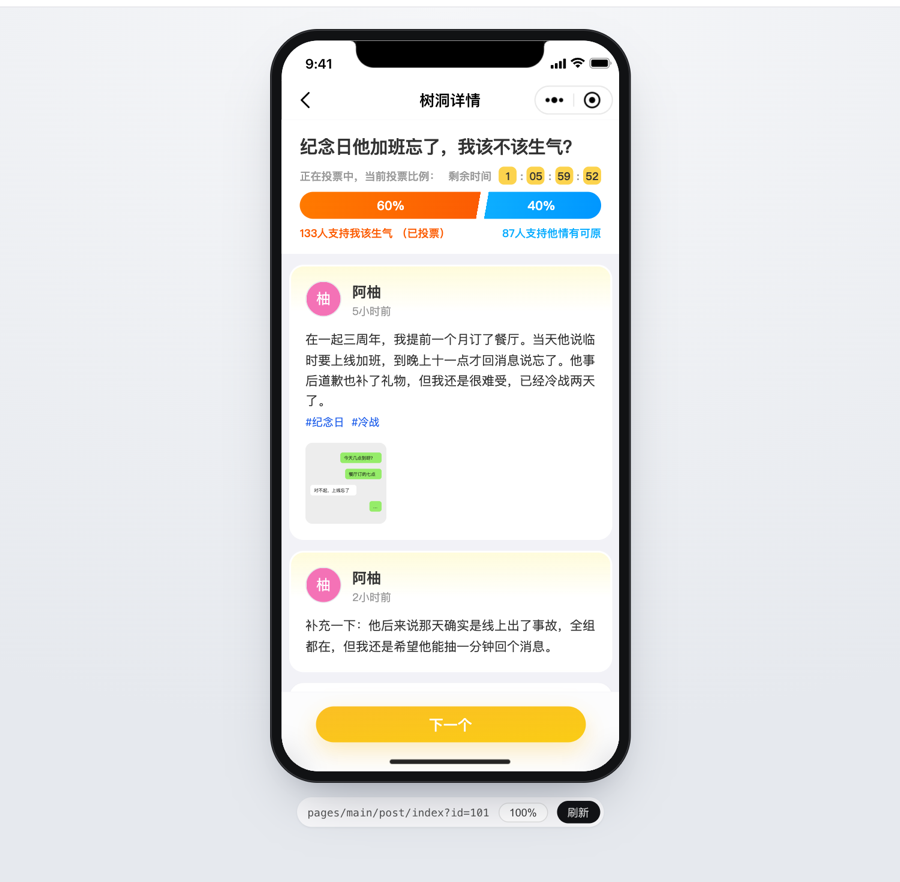

# wxa-runner

> 在普通浏览器里，用**微信官方基础库**运行小程序。用于本地调试和 E2E 自动化测试。

**[文档](https://open-wxa.github.io/wxa-runner/)** · [在线预览](https://wxa-viewer.picfinder.workers.dev) · [English](./README.en.md) · 中文

```bash
npx wxa-runner dev ./dist/dev/mp-weixin   # 原生小程序目录，或 uni-app / Taro 编译产物
# → http://localhost:3000
```

[在线预览](https://wxa-viewer.picfinder.workers.dev)：不用安装，在浏览器里打开一个 uni-app 小程序，看它在 web 上的渲染效果。
演示用[查看器](https://open-wxa.github.io/wxa-runner/viewer)部署，接口都由 setup 用 mock 数据应答，投票、评论、发帖都能操作，刷新后恢复原样。

<a href="https://wxa-viewer.picfinder.workers.dev"></a>

- **和真机一致**：直接运行小程序的编译产物，渲染、组件、`setData`、生命周期都是微信官方基础库的代码，不是 H5 那样由框架重新实现
- **无头 E2E**：用 Playwright 直接在浏览器里测试，不用远程控制开发者工具；CI 里无头运行，Linux 上不需要开发者工具
- **用熟悉的工具调试**：Chrome DevTools 打断点、看网络请求、看 DOM，保存后热更新
- **跳过走不通的环节**：在 setup 里预置登录态、mock 原生 API、拦截请求，不用改业务代码
- **直接打开任意页面**：地址加上 `?path=pages/detail/detail&id=1`，开发和测试都能直接定位到页面

它不替代开发者工具：预览、上传、真机调试仍然要用开发者工具。

## 文档

- [快速开始](https://open-wxa.github.io/wxa-runner/getting-started)：安装、基础库和编译器
- [启动前准备（setup）](https://open-wxa.github.io/wxa-runner/setup)：跳过登录、mock 原生 API、拦截 `wx.request`
- [借用开发者工具登录态](https://open-wxa.github.io/wxa-runner/devtools-login)：拿真实的 code 和手机号，调用服务市场，使用插件页面
- [热更新](https://open-wxa.github.io/wxa-runner/hot-reload)
- [查看器](https://open-wxa.github.io/wxa-runner/viewer)：不带源码在浏览器里运行，导出成静态站点发给别人看
- [在 Playwright 中测试](https://open-wxa.github.io/wxa-runner/testing)
- [uni-app 项目的 E2E 测试](https://open-wxa.github.io/wxa-runner/uni-app)
- [在 CI 中运行](https://open-wxa.github.io/wxa-runner/ci)：Linux 上无头运行，不装开发者工具
- [测试 API](https://open-wxa.github.io/wxa-runner/test-api)：不用 Playwright fixture 时直接调用
- [命令与环境变量](https://open-wxa.github.io/wxa-runner/cli)
- [功能与限制](https://open-wxa.github.io/wxa-runner/features)
- [和 miniprogram-automator 对比](https://open-wxa.github.io/wxa-runner/vs-miniprogram-automator)
- [常见问题](https://open-wxa.github.io/wxa-runner/faq)

## 参与开发

从源码构建、运行示例和测试见 [CONTRIBUTING.md](./CONTRIBUTING.md)。欢迎提交 Issue 和 PR。

## 致谢

- 微信团队：官方基础库与编译器
- [WEPT](https://github.com/chemzqm/wept)：最早验证了在浏览器中运行小程序的可行性

## 许可证

[MIT](./LICENSE)。内置基础库 [wxa-baselib](https://github.com/open-wxa/wxa-baselib) 是微信官方代码，版权归腾讯所有，不适用本项目的 MIT 协议。
